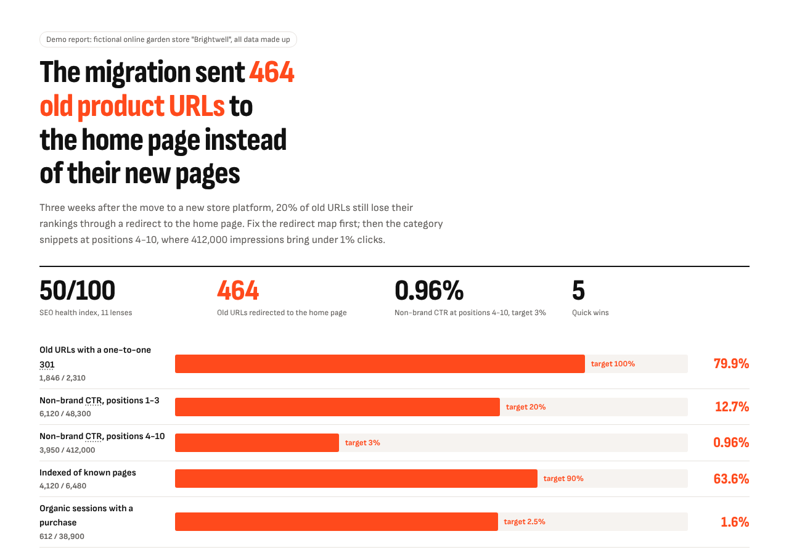
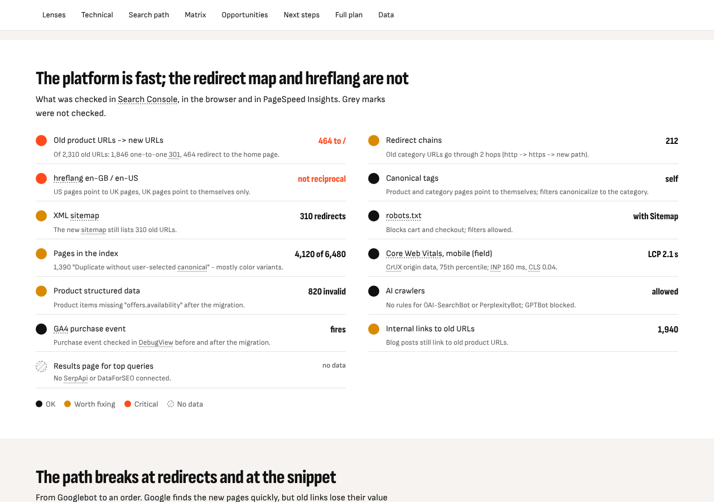
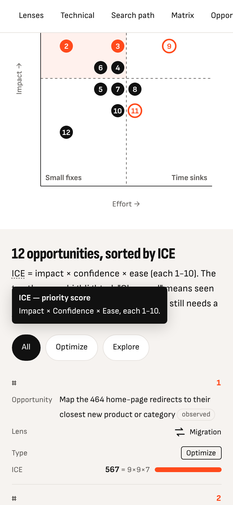

# SEO Audit

A Claude skill that audits a website's search performance through **11 SEO lenses** and delivers two outputs from the same data: a visual, evidence-based **report for people** and a **hands-off brief for AI agents** that implement the fixes. It reads Google Search Console, GA4, PageSpeed Insights and the live site **read-only**, and never invents a number to fill a gap.

**Live demo:** [English](https://claude.ai/artifact/WY6Vo8mEAYck5h31ha9LYh) (fictional online store "Brightwell" after a platform migration, made-up data).

Companion skill: [product-lens-audit](https://github.com/artemhorbenko/product-lens-audit) audits the product and its strategy (CRO, JTBD, growth loops...). This one stays on search.

### The 11 lenses

| Group | Lens | The question it asks |
|---|---|---|
| Access for search | **Indexing and crawl** | Which pages are indexed, which are not, and why? What does Googlebot get back? |
| | **Technical base** | Status codes, redirects, canonicals, hreflang, sitemap, robots.txt, Core Web Vitals, bot protection |
| | **Migration and redesign risk** | Did every old URL get a one-to-one 301? Do hreflang, canonicals and sitemaps use the new URLs? |
| Match the query | **Clusters and cannibalization** | Which page answers each query group, and do two pages fight for one group? |
| | **Content depth and freshness** | Does the ranking page fully answer the query? Are language versions thinner? |
| | **Internal links** | Do money pages get links with descriptive anchors? Do links still point to old URLs? |
| Chosen in results | **CTR vs position and snippets** | Which pages rank on page 1 but get no clicks, and why? |
| | **Structured data** | Valid, honest markup in the page's language? |
| | **AI search visibility** | Can AI search crawlers reach the site, and can answer engines quote its facts? |
| Authority and demand | **Backlinks and authority** | Who links to the site, and do those links land on live pages? |
| | **Brand vs non-brand** | Does the site live on its name, or do new customers find it? |

Plus a **search maturity stage** (crawlable, indexed, ranking, clicked, converting) and ICE prioritization with observed/hypothesis labels, alternatives, success thresholds and a pre-mortem for the top 3.



## What you get

- **The biggest leak first.** The headline names it with its number, for example "the migration sent 464 old product URLs to the home page".
- **Leaks vs target**: CTR by position band (non-brand), indexed vs known pages, one-to-one redirects, organic sessions with a conversion. A missing source shows as "no data", never as a guess.
- **Technical checklist** with ok / worth fixing / critical / no data marks: redirects, hreflang, canonicals, sitemap, robots.txt, AI crawlers, Core Web Vitals (field or lab, labelled), structured data, analytics events, bot protection.
- **SEO lens radar**, a search path from Googlebot to an order, and an impact-effort matrix.
- **Fixes ranked by ICE**, each with evidence (GSC rows, URLs, status codes), concrete steps, metric, effort and risk. The top 3 also get alternatives, an experiment with a success threshold, a pre-mortem and two title/description variants when the fix is a snippet.
- **Tooltips for every term** (CTR, hreflang, canonical, LCP, CrUX, 301, 429...): hover on desktop, tap on phone or tablet.
- **Honest confidence**: which sources were used, which were partial or missing, and the answers to the start questions.

<p>


</p>

## Two outputs

| | Report for people | Hands-off brief for agents |
|---|---|---|
| File | `report.html` (published as a page) | `audit.handoff.md` (+ optional `audit.handoff.json`) |
| Made for | owners, marketers, managers | Claude Code, Cursor, a CMS agent, or a developer |
| Looks like | annual-report design, charts, icons, tooltips | plain Markdown, no design |
| Contains | the biggest leak, leaks vs target, checklist, lens radar, matrix, ranked plan | site context, constraints, decisions for a human, tasks `SEO-01`... sorted by ICE with exact targets (URL, now, expected), steps, **acceptance criteria an agent can verify**, dependencies, owner, risk, rollback |

Example brief for the fictional demo store: [docs/example.handoff.md](docs/example.handoff.md).

Both are built from one `audit.json` (`build_report.py`, `build_handoff.py`), so they never disagree. Hand the brief to your coding agent: *"Implement SEO-01 to SEO-03 from audit.handoff.md and report which acceptance criteria pass."*

## How it works

1. **Checks connected sources** - browser (for the Search Console and GA4 web UIs and the site), GSC / GA4 connectors, Ahrefs, DataForSEO, SerpApi, PageSpeed Insights / CrUX, a CMS connector for this site - and marks each as used, partial or missing.
2. **Asks up to 4 quick questions**, each skippable: what search should bring, which markets, what changed recently (redesign, URLs, domain), what was already done. An owner's claim ("all 301s are set") is verified on a sample.
3. **Gathers** GSC performance, indexing, sitemaps, crawl stats and URL Inspection; GA4 channels and key events; robots.txt, sitemaps and old-to-new redirects on the live site; PageSpeed. It goes slowly and stops at the first 429 or bot check instead of bypassing it.
4. **Applies the 11 lenses**, ties every finding to evidence, and ranks fixes with ICE.
5. **Writes one `audit.json`** and builds both outputs: validates it (`validate_audit.py`: every finding has evidence, every number in KPIs, leaks and checks names a source that is not missing, the top 3 have alternatives and a pre-mortem), builds the page (`build_report.py`) and the hands-off brief (`build_handoff.py`), **checks that the page renders** on desktop, tablet and phone (`check_report.py`), and runs a **fact check** of every number against the raw data (in Claude Code, by a separate agent).

Read-only by design: no "Request indexing", no sitemap submits, no redirect or setting changes.

## Install

### Claude Code (terminal, desktop app, VS Code)

```
/plugin marketplace add artemhorbenko/seo-audit
/plugin install seo-audit@seo-audit
```

Then ask, for example: *"Run an SEO audit of example.com; we moved to a new CMS last week"*.

### Claude app (claude.ai, desktop, mobile)

1. Download `seo-audit-skill.zip` from this repository ([direct download](https://github.com/artemhorbenko/seo-audit/raw/main/seo-audit-skill.zip)).
2. Make sure code execution is on (Settings → Capabilities).
3. Go to **Customize → Skills**, click **+**, then **Create skill → Upload a skill**, and choose the ZIP.

See Anthropic's guide: [Use skills in Claude](https://support.claude.com/en/articles/12512180-use-skills-in-claude).

### Any other agent that reads SKILL.md

Copy `plugins/seo-audit/skills/seo-audit/` into your agent's skills folder.

## Data sources

The skill works with just a URL, but Search Console is what makes it sharp. Connect what you have, read-only:

| Data | Options |
|---|---|
| Search Console | The GSC web UI via Claude in Chrome (your sign-in), a GSC MCP server, Ahrefs' GSC tools, or screenshots |
| GA4 | Google's official GA4 MCP server, the GA4 UI via a browser, or screenshots |
| Speed | PageSpeed Insights (API or pagespeed.web.dev), CrUX |
| Backlinks, SERP, volumes | Ahrefs, DataForSEO, SerpApi, Semrush (optional) |
| The site | Any browser tool; a CMS connector for the same site |

## Build and check a report yourself

```
S=plugins/seo-audit/skills/seo-audit
python $S/scripts/validate_audit.py audit.json          # data and rules, standard library only
python $S/scripts/build_report.py audit.json report.html
python $S/scripts/build_handoff.py audit.json audit.handoff.md --json audit.handoff.json
pip install playwright && playwright install chromium
python $S/scripts/check_report.py report.html --out ./report-check
```

Start from `$S/assets/example-audit.en.json` (or the Ukrainian `example-audit.json`); the shape is in `$S/references/audit.schema.json`. For screenshots in the real typeface without network access to Google Fonts, install Sofia Sans and Sofia Sans Condensed locally.

## Privacy and safety

- Every source is used read-only. The skill does not request indexing, submit sitemaps, change settings or submit forms, and never bypasses CAPTCHAs or bot protection.
- It never invents numbers, search volumes, rankings, backlinks or AI-answer appearances, and it does not recommend doorway pages, bought links, fake reviews in schema or fake "updated" dates.
- The report is one self-contained HTML file; nothing is sent anywhere by the report itself.

## Repository layout

```
.claude-plugin/marketplace.json        marketplace catalog (this repo)
plugins/seo-audit/
  .claude-plugin/plugin.json
  skills/seo-audit/
    SKILL.md                           the process
    references/lenses.md               the 11 SEO lenses and the maturity stage
    references/data-sources.md         what to read in GSC, GA4, the site, PageSpeed; fallbacks; read-only rules
    references/report-spec.md          report sections, tooltips, mobile rules
    references/handoff-spec.md         hands-off brief for agents: targets, acceptance criteria
    references/audit.schema.json       shape of the report data
    assets/report-template.html        the report page; renders from one JSON block
    assets/example-audit.json          full example, Ukrainian (fictional "Brightwell")
    assets/example-audit.en.json       the same example in English
    scripts/validate_audit.py          data and rule check
    scripts/build_report.py            audit.json -> report.html
    scripts/build_handoff.py           audit.json -> audit.handoff.md / .json
    scripts/check_report.py            headless render check
evals/                                 test scenarios, trigger prompts, results log
docs/                                  screenshots
seo-audit-skill.zip                    the skill packaged for upload to the Claude app
```

## Roadmap

See [ROADMAP.md](ROADMAP.md).

## License

MIT - see [LICENSE](LICENSE).

---

## Українською

**SEO Audit** - скіл для Claude, який перевіряє пошукову видимість сайту через 11 SEO-лінз і видає візуальний звіт: найбільша втрата в заголовку, втрати проти цілі, технічний чекліст, шлях від Googlebot до заявки, матриця вплив-зусилля і пріоритизований план виправлень. Біля кожної знахідки є доказ (рядки Search Console, URL, коди відповідей), а кожен термін має підказку. Дані читаються лише на читання: без запитів на індексацію, без змін налаштувань, без обходу захисту від ботів. Чого немає в джерелах, того немає й у звіті: на місці числа стоїть «немає даних».

**Демо-звіт:** [англійською](https://claude.ai/artifact/WY6Vo8mEAYck5h31ha9LYh) (вигаданий магазин «Brightwell» після міграції, умовні дані). Українська версія того самого прикладу - `assets/example-audit.json`.

**11 лінз у 4 групах:**
- **Доступ для пошуку:** індексація і краулінг; технічна база (коди відповідей, редиректи, canonical, hreflang, sitemap, robots.txt, Core Web Vitals); ризики міграції й редизайну.
- **Відповідність запиту:** кластери запитів і канібалізація; глибина і свіжість контенту; внутрішні посилання.
- **Вибір у видачі:** CTR проти позиції і сніпети; структуровані дані; видимість в AI-пошуку.
- **Авторитет і попит:** беклінки; брендовий проти небрендового попиту.

**Джерела:** Search Console, GA4, PageSpeed Insights / CrUX, сам сайт у браузері; за наявності - Ahrefs, DataForSEO, SerpApi, CMS-конектор. Стратегія продукту - у скілі [product-lens-audit](https://github.com/artemhorbenko/product-lens-audit).

Встановлення в Claude Code:

```
/plugin marketplace add artemhorbenko/seo-audit
/plugin install seo-audit@seo-audit
```

**Два результати з одного `audit.json`:** звіт із дизайном для людей і hands-off бриф у Markdown для AI-агентів (контекст, обмеження, рішення для людини, задачі `SEO-01`… з точними URL, поточними й потрібними значеннями, кроками й критеріями приймання, які агент може перевірити сам).

Для Claude app завантажте ZIP з репозиторію ([пряме завантаження](https://github.com/artemhorbenko/seo-audit/raw/main/seo-audit-skill.zip)), потім **Customize → Skills → + → Create skill → Upload a skill**.
